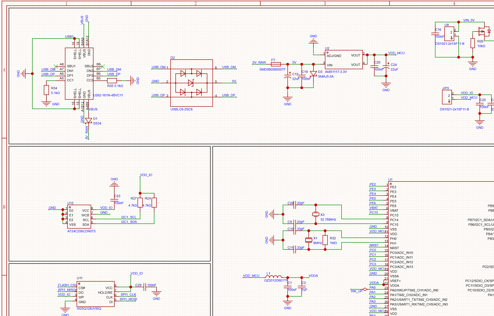
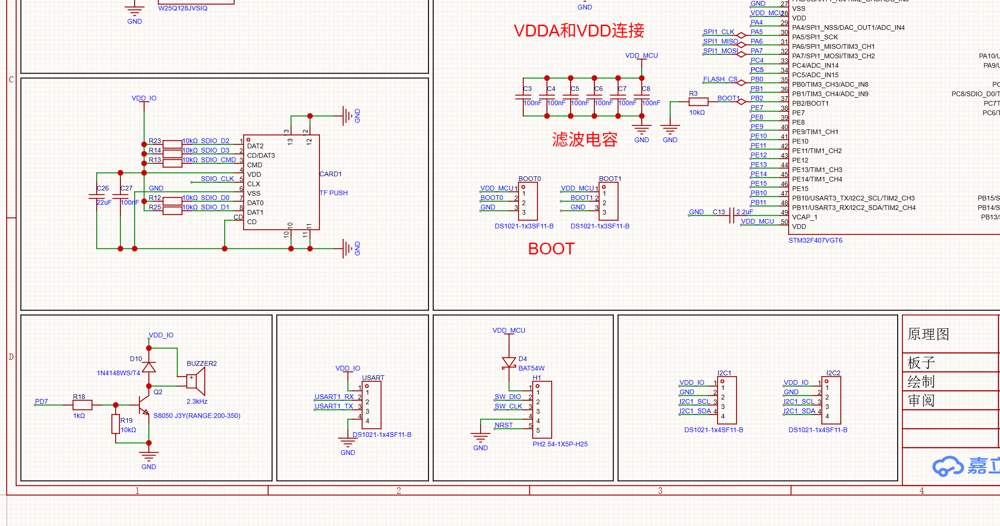
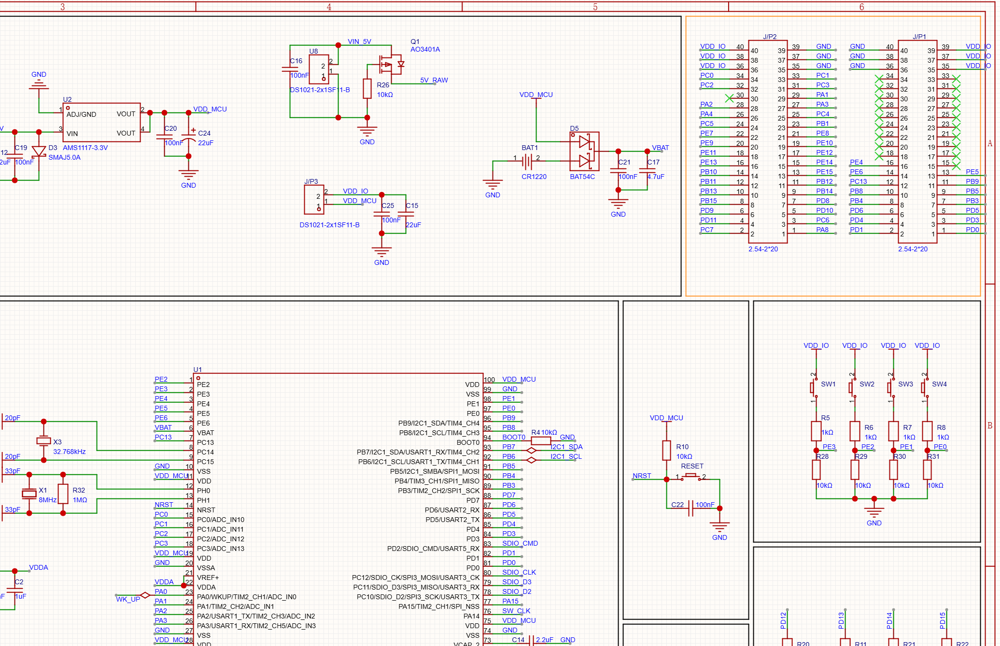
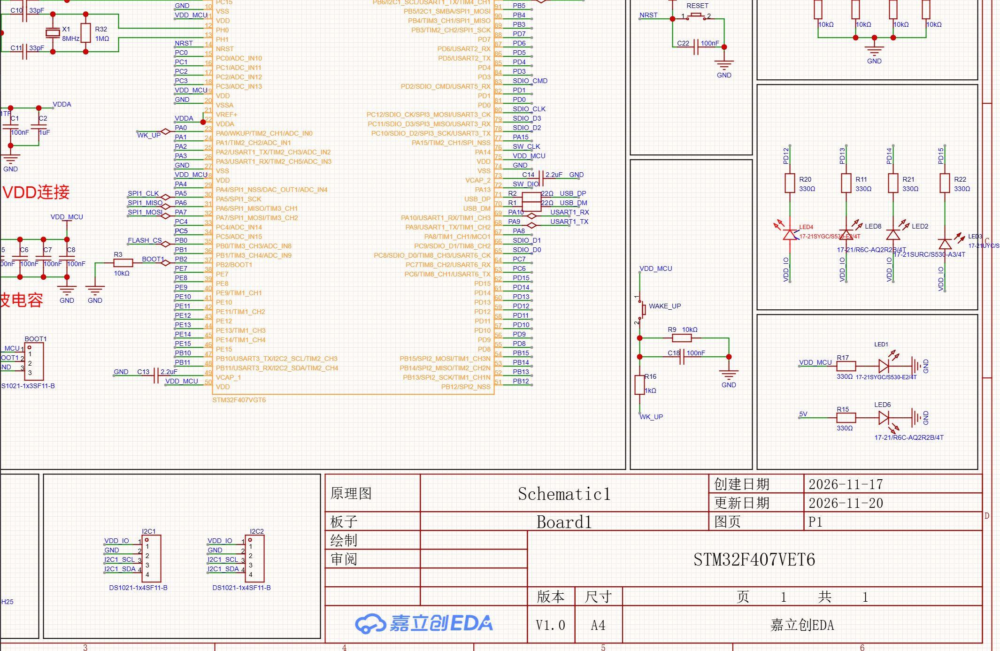
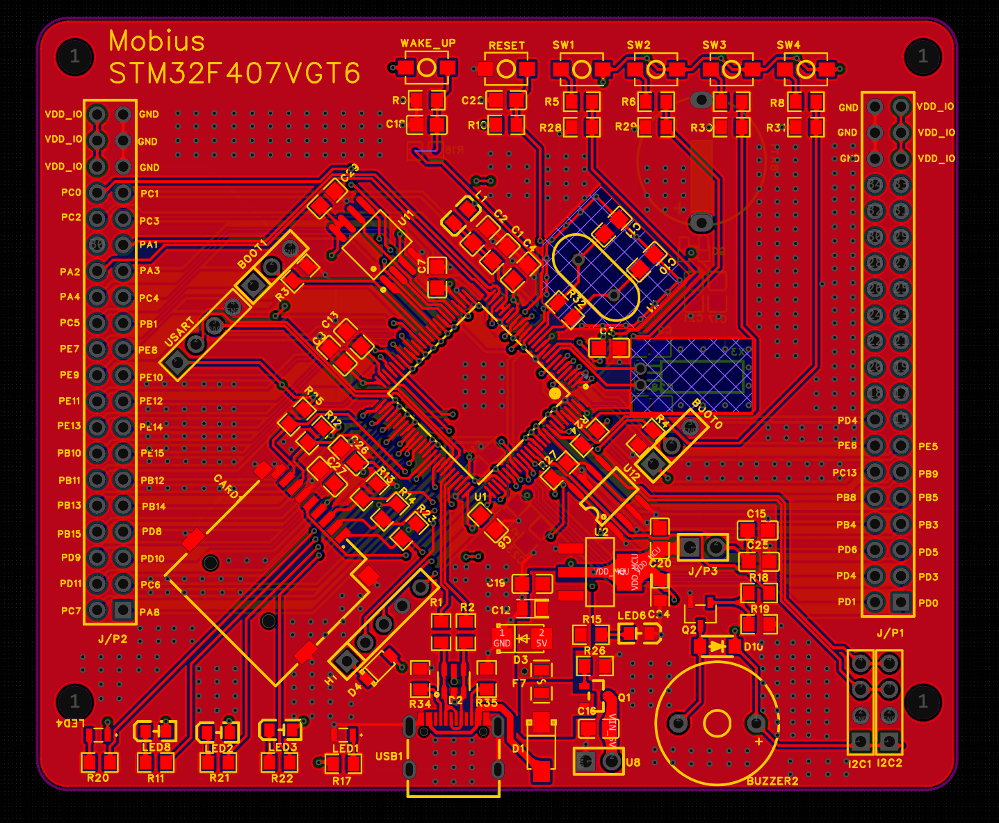
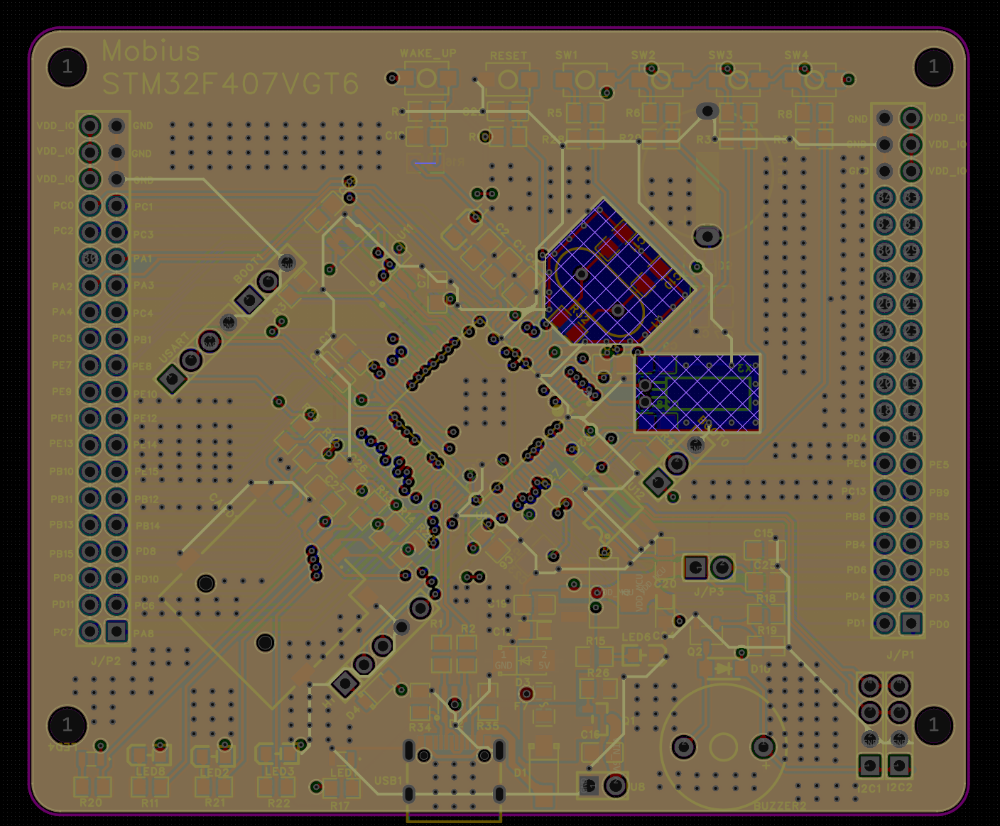
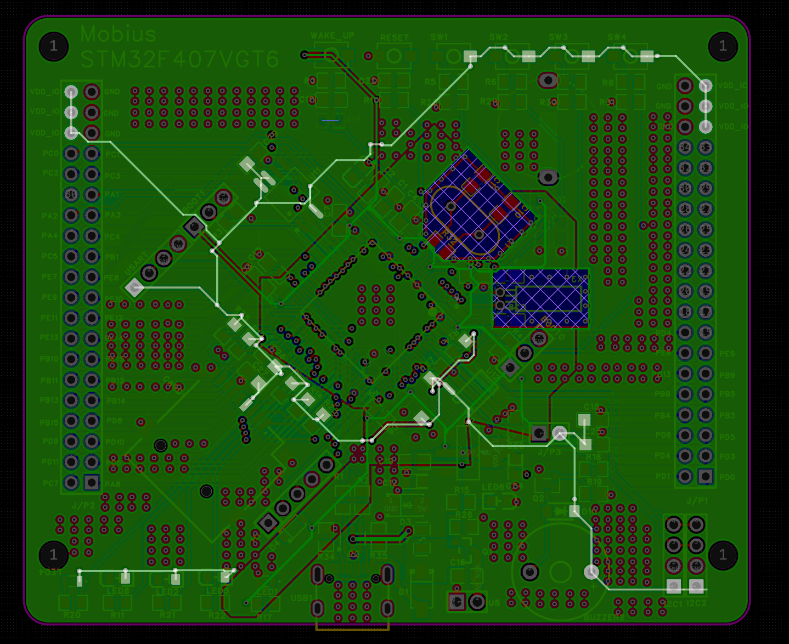
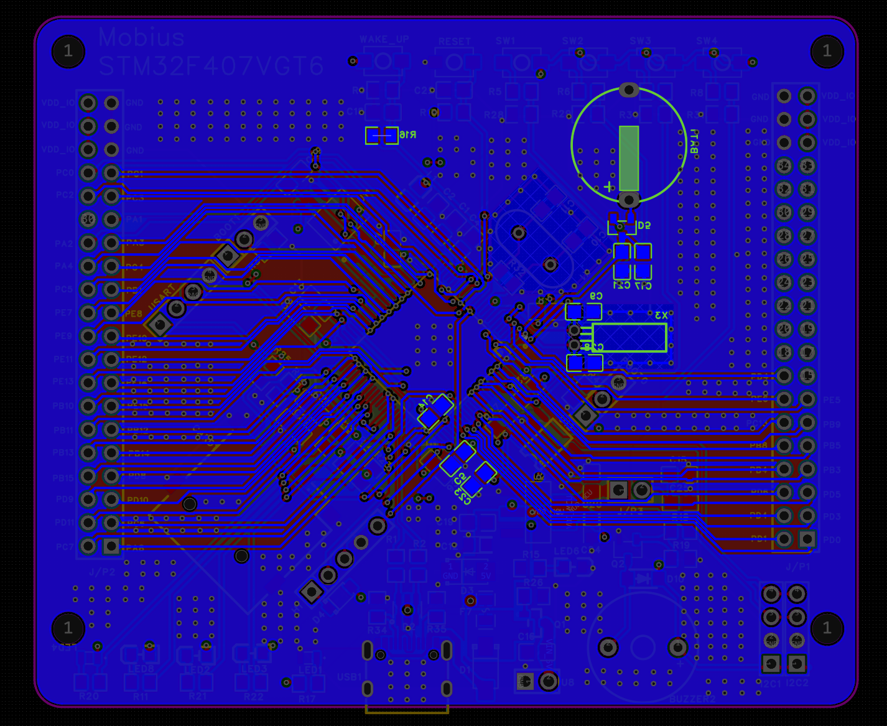

# 板子 · Mobius STM32F407VGT6

基于 **STM32F407VGT6** 的学习 / 验证板（Mobius）开源硬件工程，使用 **嘉立创 EDA 专业版（EasyEDA Pro）** 设计。

工程包含完整原理图、PCB 源文件（`.epro2`）以及原理图与 PCB 的预览图。

---

## 硬件概览

| 项目 | 说明 |
| --- | --- |
| 主控 | STM32F407VGT6（LQFP100，ARM Cortex-M4，1 MB Flash / 192 KB RAM） |
| 供电 | USB 5V 输入 → AMS1117-3.3 稳压至 3.3V；VBAT 由 CR1220 纽扣电池供电 |
| 下载调试 | SWD（SW_DIO / SW_CLK）+ NRST，标准 2.54mm 排针 |
| 存储 | W25Q128 SPI Flash（16 MB）、AT24C256 I2C EEPROM（32 KB） |
| 人机交互 | 4 个独立按键（SW1–SW4）、RESET、WAKE_UP、4 个 LED、2.3 kHz 有源蜂鸣器 |
| 扩展 | TF 卡座（SDIO）、USB Type-C 接口、USART 排针、I2C 接口、2×20 双排引出全部 IO |
| 时钟 | 8 MHz 主晶振、32.768 kHz RTC 晶振 |
| 板卡形态 | 四角定位孔，板边 2×20 双排排针引出全部 IO，板面大面积铺铜 |

### 主要器件

- `U1` STM32F407VGT6
- `U2` AMS1117-3.3（3.3V LDO）
- `U8` / `U12` DS1021 系列跳线、AT24C256CDR073（EEPROM）
- `U11` W25Q128JVSIQ（SPI Flash）
- `USB1` U262-161N-4BVC11（USB Type-C 16Pin）
- `D2` USBLC6-2SC6（USB ESD 保护）
- `Q1` AO3401A（P-MOS 电源开关）
- `Q2` S8050（蜂鸣器驱动）
- `BAT1` CR1220 + `D5` BAT54C（VBAT 电源切换）

---

## 目录结构

```
板子/
├─ README.md
└─ STM32F407VGT6_1/
   ├─ STM32F407VGT6_1.epro2     # 嘉立创 EDA 专业版工程（原理图 + PCB）
   └─ 预览/
      ├─ 原理图/                # 原理图预览（4 张）
      │  ├─ 原理图-1.png
      │  ├─ 原理图-2.png
      │  ├─ 原理图-3.png
      │  └─ 原理图-4.png
      └─ PCB/                   # PCB 预览（4 张）
         ├─ PCB-1.png
         ├─ PCB-2.png
         ├─ PCB-3.png
         └─ PCB-4.png
```

---

## 原理图预览

| 原理图-1 | 原理图-2 |
| --- | --- |
|  |  |

| 原理图-3 | 原理图-4 |
| --- | --- |
|  |  |

---

## PCB 预览

| PCB-1 | PCB-2 |
| --- | --- |
|  |  |

| PCB-3 | PCB-4 |
| --- | --- |
|  |  |

---

## 打开工程

1. 下载并安装 [嘉立创 EDA 专业版](https://pro.lceda.cn/)。
2. 打开 `STM32F407VGT6_1/STM32F407VGT6_1.epro2`。
3. 左侧工程树中可切换「原理图」与「PCB」，可直接查看 / 修改 / 导出制造文件（Gerber、BOM、坐标文件）。

> 本仓库仅作学习与参考，打样前请自行复核原理图与 PCB（尤其是电源、复位、BOOT 与 USB 部分）。
